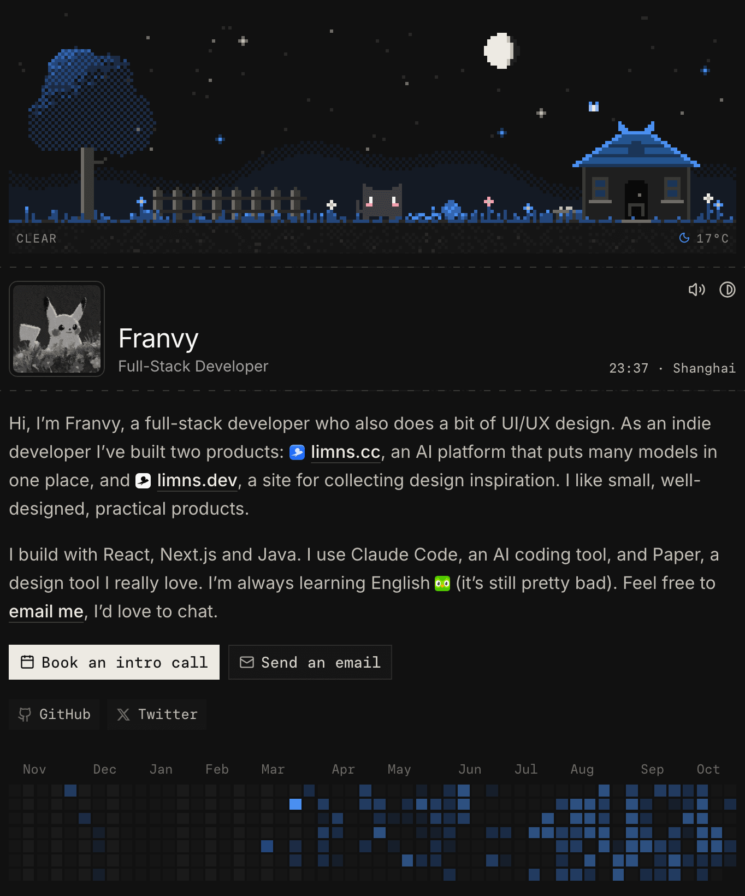

<div align="center">

# glyph

一个 ASCII 风格的个人网站，顶部的像素花园会跟着真实的天空变化。

[**franvy.cc**](https://franvy.cc) · [本地运行](#本地运行) · [部署你自己的版本](#部署你自己的版本)

[English](README.md) · **简体中文**



</div>

## 亮点

- **会变的横幅。** 像素花园跟着上海的当地时间、月相和实时天气变化。
- **节日主题。** 春节、中秋这些中国节日，页面会换上对应的主题。
- **等距视角的项目插图。** 每个项目都是一台会动的小机器，由 `figures/` 里的脚本画出来。
- **煤球。** 页脚住着一只像素猫，可以摸它，网站会记下每一次摸摸。
- **对 Agent 友好。** [`/index.md`](https://franvy.cc/index.md) 以 Markdown 格式输出首页。
- **自带编辑器。** 在 `/admin` 里编辑首页内容，由 Cloudflare Access 保护。

## 技术栈

[Astro](https://astro.build) 7 + TypeScript，整站跑在一个 [Cloudflare Worker](https://developers.cloudflare.com/workers/) 上。
D1（配合 Drizzle）存内容和计数，R2 存上传的媒体文件。
样式用 Tailwind CSS v4，只有需要交互的地方才用 React island。
测试用 Vitest 和 Playwright。

## 本地运行

需要 Node.js 24 和 pnpm（运行 `corepack enable` 会自动用上项目锁定的版本）。

```sh
git clone https://github.com/Franvy/glyph.git && cd glyph
pnpm install
pnpm db:migrate:local   # 创建本地 D1 表
pnpm dev                # http://localhost:4321
```

不配置 token 也能跑起来。想看到实时数据，把 `.env.example` 复制成 `.dev.vars`，
填上 `GITHUB_TOKEN`（贡献日历）和 `CAIYUN_TOKEN`（天气）。

提 PR 之前，先跑一遍 `pnpm check && pnpm test && pnpm e2e`。
代码、数据库和测试的规范都写在 [`CLAUDE.md`](CLAUDE.md) 里。

## 部署你自己的版本

1. 把 `src/lib/site.ts` 改成你自己的内容，替换 `src/assets/` 里的图片。
2. 创建数据库和存储桶：
   `pnpm dlx wrangler d1 create glyph-db` 和 `pnpm dlx wrangler r2 bucket create glyph-media`。
3. 在 `wrangler.jsonc` 里填上你的 `database_id`、域名和 Cloudflare Access 的配置。
   `astro.config.mjs` 里的 `site` 也改成同一个域名。
4. 用 `pnpm dlx wrangler secret put <NAME>` 添加 token。
5. 在 GitHub 仓库的 Secrets 里添加 `CLOUDFLARE_API_TOKEN` 和 `CLOUDFLARE_ACCOUNT_ID`。
   之后每次推送到 `main`，CI 都会跑检查、执行数据库迁移，然后部署。

## 许可

代码使用 [MIT 许可](LICENSE)。Paper Mono 字体使用
[SIL Open Font License](src/assets/fonts/PaperMono-OFL.txt)。
头像、个人内容和第三方 logo 不在 MIT 许可范围内。
